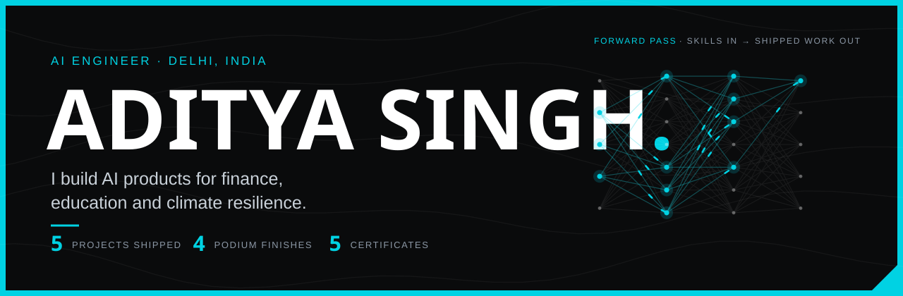
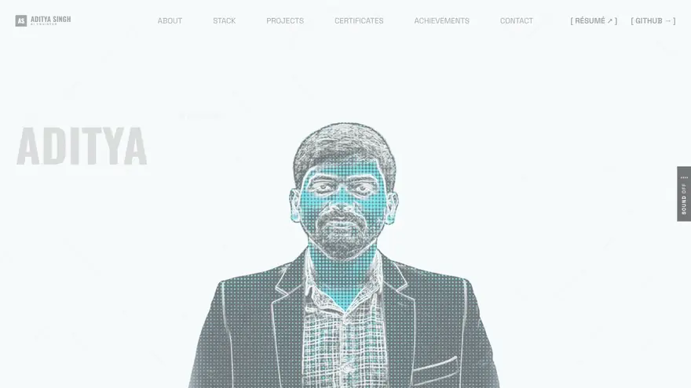

  
  
  
  
  
  

  

## About me

I'm Aditya, an AI engineer finishing an MCA in Generative AI at SRM IST. I build end-to-end AI products: forecasting and quant research for finance, LLM and RAG tools for education, and computer vision with GIS for climate resilience.

- 🎓 **MCA, Generative AI** at SRM IST (2025–27) · BCA, Data Science (2022–25)
- 🚀 **Google Student Ambassador** (2025)
- 🏆 **4 hackathon podium finishes** across 10+ hackathons
- 💼 **Open to AI/ML engineering roles** · Delhi, on-site or hybrid

 

My portfolio: a WebGL portrait, every project in one scroll, and a footer that runs a live forward pass. <a href="https://aditya-singh-ai-engineer.vercel.app/"><b>Open it →</b></a>

## Featured projects

<table>
<tr>
<td colspan="2">

### 📈 AlphaForage &nbsp;<code>QUANT ML</code> · <b>LIVE</b>

Forecasts markets with **XGBoost, LSTM and Transformer** models on leakage-free chronological splits, detects market regimes with an **HMM**, and runs every strategy through an **Honesty Engine** (Deflated Sharpe, probability of backtest overfitting, walk-forward, Monte Carlo) that rejects edges that are only overfit.

`XGBoost` `LSTM` `Transformer` `HMM` `Monte Carlo` `FastAPI`

**[Live demo](https://alpha-forage.vercel.app)** · **[Code](https://github.com/ADITYASINGH77770000/AlphaForage)**

</td>
</tr>
<tr>
<td width="50%" valign="top">

### 🛡️ Denominator
<code>EXPLAINABLE ML</code>

Calibrated **XGBoost** fraud scoring on 118K held-out transactions (PR-AUC 2× a logistic baseline), **SHAP** explanations, **EWMA drift detection** and **Gemini**-written analyst notes, served through FastAPI.

`XGBoost` `SHAP` `Calibration` `Drift detection` `LLM`

**[Code](https://github.com/ADITYASINGH77770000/Denominator)**

</td>
<td width="50%" valign="top">

### 🌧️ RainGuard AI
<code>DEEP LEARNING · RL · RAG</code>

An **ANN** predicts flood risk from live weather, a **reinforcement-learning** policy decides when to alert, **computer vision** reads satellite and flood imagery, and a **RAG** assistant answers from official disaster guidelines.

`TensorFlow` `RL` `OpenCV` `RAG` `LangChain` `Gemini`

**[Code](https://github.com/ADITYASINGH77770000/Rain-Guard-AI)**

</td>
</tr>
<tr>
<td width="50%" valign="top">

### 💹 Finnovix
<code>TIME-SERIES DL</code>

**LSTM** stock-price forecasting with **anomaly detection** and automated report generation, wrapped in an assistant for non-technical users.

`LSTM` `TensorFlow` `Anomaly detection` `Streamlit`

**[Live demo](https://finnovix-bot-4.onrender.com/)** · **[Code](https://github.com/ADITYASINGH77770000/Finance-Bot)**

</td>
<td width="50%" valign="top">

### 🧠 BrainWave
<code>GENAI · NLP</code>

A **Gemini**-powered learning assistant: code generation, Q&A and summarisation, built on NLP pipelines with **Transformers** and **spaCy**.

`Gemini` `LLMs` `Transformers` `spaCy`

**[Code](https://github.com/ADITYASINGH77770000/BrainWave)**

</td>
</tr>
</table>

## On the podium

<table>
<tr>
<td align="center" width="25%">🥇 <b>Champions</b> Code Jam Hackathon SRM IST · Jan 2025</td>
<td align="center" width="25%">🥈 <b>Runner-up</b> Avinya '25 NSUT · Apr 2025</td>
<td align="center" width="25%">🏆 <b>Best Use of Gen AI</b> HackHound 3.0 Mar 2025</td>
<td align="center" width="25%">🏅 <b>Top-5 team</b> Cube Innovators Hackathon Tryst '25 · IIT Delhi</td>
</tr>
</table>

**Certificates:** Google Student Ambassador · LLM Engineering (Udemy) · Data Science internships at CodeClause and Encryptix · ISRO Bharatiya Antariksh Hackathon 2026

## Tech stack

  

  
  
  
  
  
  
  
  
  

## Writing

I break down ML systems on LinkedIn: how multimodal inference really runs on a GPU, why quantum computers don't "try every answer at once", and how to tell a real trading edge from an overfit one. **[Read my posts →](https://www.linkedin.com/in/aditya-singh-7210b2267/recent-activity/all/)**

 

  
    
  <b>Keep building forward.</b>

