  
  
  
  
  

### Hey, I'm Aditya 👋

I build AI systems end to end, from the model to the API to the dashboard someone actually uses. Most of my work sits where ML meets real decisions: forecasting markets, scoring fraud risk, predicting floods.

- 🎓 MCA in Generative AI at **SRM IST** (2025–27), after a BCA in Data Science
- 💼 Google Student Ambassador · Data Science Intern at CodeClause · ML Intern at Encryptix
- 🏆 4 hackathon podium finishes across 10+ hackathons
- ✍️ I write deep-dives on ML systems on [LinkedIn](https://www.linkedin.com/in/aditya-singh-7210b2267/recent-activity/all/)

### 🔬 Projects

| Project | What the AI does | Built with |
| :-- | :-- | :-- |
| **[AlphaForage](https://github.com/ADITYASINGH77770000/AlphaForage)** [live demo ↗](https://alpha-forage.vercel.app) | Forecasts markets with XGBoost, LSTM and Transformer models, detects regimes with an HMM, and rejects overfit strategies using Deflated Sharpe and backtest-overfitting tests | XGBoost · LSTM · FastAPI |
| **[Denominator](https://github.com/ADITYASINGH77770000/Denominator)** | Calibrated XGBoost fraud scoring with SHAP explanations, drift detection and Gemini-written analyst notes for a payment aggregator | XGBoost · SHAP · FastAPI |
| **[RainGuard AI](https://github.com/ADITYASINGH77770000/Rain-Guard-AI)** | A flood-risk ANN, a reinforcement-learning alert policy, computer vision on imagery and a RAG assistant over disaster guidelines | TensorFlow · OpenCV · LangChain |
| **[Finnovix](https://github.com/ADITYASINGH77770000/Finance-Bot)** [live demo ↗](https://finnovix-bot-4.onrender.com/) | LSTM stock forecasting with anomaly detection and automated reports, behind an assistant for non-technical users | TensorFlow · Streamlit |
| **[BrainWave](https://github.com/ADITYASINGH77770000/BrainWave)** | A Gemini-powered learning assistant for code generation, Q&A and summaries, on Transformers and spaCy NLP pipelines | Gemini · Transformers · spaCy |

### 🏁 Hackathons

- 🥇 **Champions**, Code Jam Hackathon · SRM IST, Jan 2025
- 🥈 **Runner-up**, Avinya '25 · NSUT, Apr 2025
- 🏆 **Best Use of Gen AI**, HackHound 3.0 · Mar 2025
- 🎖️ **Top 5**, Cube Innovators Hackathon · Tryst '25, IIT Delhi, Mar 2025

Also: LLM Engineering (Udemy) · ISRO Bharatiya Antariksh Hackathon 2026

### 🧰 Toolbox

| Area | Tools |
| :-- | :-- |
| **Languages** |   |
| **ML & DL** |      |
| **GenAI & NLP** |     |
| **Data & deploy** |        |

### 🐍 My contributions, eaten

<picture>
  <source media="(prefers-color-scheme: dark)" srcset="https://raw.githubusercontent.com/ADITYASINGH77770000/ADITYASINGH77770000/output/github-snake-dark.svg">
  <source media="(prefers-color-scheme: light)" srcset="https://raw.githubusercontent.com/ADITYASINGH77770000/ADITYASINGH77770000/output/github-snake.svg">
  
</picture>

Thanks for stopping by · 

